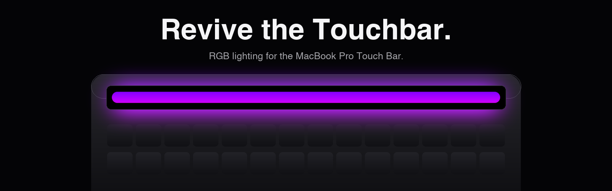
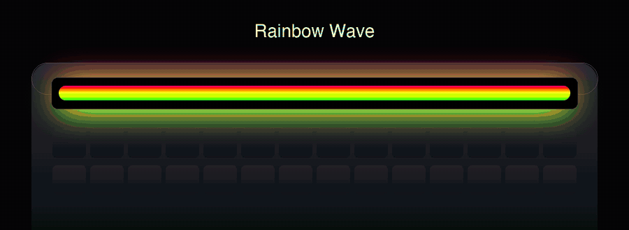

<p align="center"></p>

इसे पढ़ें: [English](README.md) · [Español](README.es.md) · [Português (Brasil)](README.pt-BR.md) · [Français](README.fr.md) · **हिन्दी** · [简体中文](README.zh-CN.md)

# Revive the Touchbar

**MacBook Pro Touch Bar के लिए RGB लाइटिंग। मुफ़्त और ओपन सोर्स।**

एक मेन्यू बार ऐप जो आपकी Touch Bar को जीवंत लाइट स्ट्रिप में बदल देता है: छह शेल्फ़ पर 49 एनिमेशन, हर हफ़्ते नए एनिमेशन, और आपका अपना टेक्स्ट और GIF।

<p align="center"><a href="https://revivethetouchbar.com"><b>Mac के लिए डाउनलोड करें</b></a> &nbsp;·&nbsp; <a href="https://revivethetouchbar.com">वेबसाइट</a></p>

## चलते हुए देखें

<p align="center"></p>

[पूरा डेमो देखें (MP4)](assets/demo-all-effects.mp4)

## इसमें क्या है

- 49 एनिमेशन: एम्बिएंट लाइट, रेट्रो, गेमिंग, प्रोडक्टिविटी, मीम्स और आपके अपने।
- हर हफ़्ते नए एनिमेशन, सीधे ऐप में।
- बार पर आपका टेक्स्ट और आपका GIF।
- F1–F12 के लिए **fn** बटन, और अदृश्य स्लाइडर: लाइटिंग पर स्लाइड करें, बाईं ओर स्क्रीन की चमक और दाईं ओर वॉल्यूम।
- स्पीड, चमक, रंग, और कोनों के आकार के लिए हार्डवेयर जैसा नॉब। अपने लुक प्रीसेट के रूप में सहेजें।

## शुरू करें

1. [revivethetouchbar.com](https://revivethetouchbar.com) से ऐप डाउनलोड करें।
2. DMG खोलें और **Revive the Touchbar** को Applications में खींचें।
3. इसे खोलें। यह मेन्यू बार में रहता है; एनिमेशन चुनने के लिए Settings खोलें।

## सोर्स से बनाएँ

आपको Xcode या Command Line Tools चाहिए (`xcode-select --install`)।

```sh
git clone https://github.com/IsaacM721/revive-the-touchbar.git
cd revive-the-touchbar
./build.sh
open "build/Revive the Touchbar.app"
```

बिल्ड यूनिवर्सल है (Apple silicon और Intel) और ad hoc साइन किया जाता है। एनिमेशन इंजन सादा Swift है; `tools/effectlab/run.sh` ऐप के बिना हर एनिमेशन रेंडर और बेंचमार्क करता है।

## ज़रूरतें

- Touch Bar वाला MacBook Pro
- macOS 13 Ventura या बाद का

## सवाल

**यह Mac App Store पर क्यों नहीं है?**

यह एक सिस्टम सुविधा से अपनी Touch Bar दिखाता है जो Apple अपने सार्वजनिक डेवलपर टूल में नहीं देता, इसलिए इसे सीधे बाँटा जाता है। वेबसाइट वाला रिलीज़ Apple से साइन और नोटराइज़्ड है।

**क्या मैं इसे बंद कर सकता हूँ?**

हाँ। मेन्यू बार आइटम में Lighting स्विच इस्तेमाल करें, और आपकी Touch Bar सामान्य हो जाएगी।

## योगदान

Issues और pull requests का स्वागत है। पहले [CONTRIBUTING.md](CONTRIBUTING.md) पढ़ें।

## लाइसेंस

MIT। [LICENSE](LICENSE) देखें। Revive the Touchbar एक स्वतंत्र प्रोजेक्ट है, Apple Inc. से संबद्ध या समर्थित नहीं। MacBook Pro और Touch Bar, Apple Inc. के ट्रेडमार्क हैं।

## मदद

बग और सुझाव: [issue खोलें](../../issues/new/choose)। सुरक्षा समस्याएँ: [SECURITY.md](SECURITY.md) देखें।
